<!-- ═══════════════ HEADER (animated waving banner) ═══════════════ -->
<div align="center">



<!-- Typing animation -->
<a href="https://www.ayyash.tech">
  
</a>

<br/>


<br/><br/>

<a href="https://www.ayyash.tech"></a>
<a href="https://www.linkedin.com/in/ayyashfous1"></a>
<a href="mailto:ahamedayyash111@gmail.com"></a>

</div>

---

## 👨‍💻 About Me

```python
class AhamedAyyash:
    role       = "AI Engineer"
    education  = "BSc Computer Engineering (Hons), UET Taxila  |  CGPA 3.79 / 4.00"
    location   = "Matara, Sri Lanka"
    focus      = ["Computer Vision", "Multi-Agent LLM Systems", "RAG Pipelines", "Deep Learning"]
    currently  = "Building & deploying AI-powered products with FastAPI"
    open_to    = ["AI/ML Engineer roles", "Software Engineering internships", "Open-source collaboration"]

    def mission(self):
        return "Turn research-grade AI into reliable, real-world solutions."
```

I'm a Computer Engineering graduate who loves building AI systems end to end, from training and evaluating models to wrapping them in APIs and shipping them. My final-year project, **Interveuu**, is a multi-agent AI interviewer that combines LLMs, computer vision and speech processing.

---

## 🛠️ Tech Stack

<div align="center">

**💻 Languages**<br/>

<br/>
   

<br/><br/>

**🧠 AI, ML & Generative AI**<br/>

<br/>
         

<br/><br/>

**📊 Data, Analytics & Cloud**<br/>

<br/>
    

<br/><br/>

**⚙️ Backend, Web & DevOps**<br/>


</div>

<br/>

| Domain | Skills & Concepts |
|---|---|
| 🧠 **Machine & Deep Learning** | Machine Learning, Deep Learning, Computer Vision, TensorFlow, PyTorch, Keras, Scikit-learn, OpenCV, Transformers, Pandas, NumPy |
| 🤖 **Generative & Agentic AI** | Gen AI, LLM Integration, Prompt Engineering, RAG, Embeddings, Vector Databases (Pinecone, Chroma), AI Agents, Multi-agent Systems, Tool Calling, Model Context Protocol (MCP), LLM Reasoning Chains, Human-in-the-loop, LangChain, LangGraph, HuggingFace, OpenAI API, n8n Automation |
| 📊 **Data Engineering & Analytics** | ETL, Data Warehouse & Data Mining, Data Analysis, Spark, Hadoop, Apache Hive, Ambari, PostgreSQL, MongoDB, Power BI, Microsoft Fabric, Excel |
| ☁️ **Cloud & DevOps** | Azure, AWS, GCP, Docker, Linux, Git, GitHub, Vercel, Automation |
| 🌐 **Backend & Web** | FastAPI, REST API, Node.js, React.js, HTML, CSS, JavaScript |
| 💻 **Languages & Low-level** | Python, C++, Java, SQL, Verilog, Assembly, Embedded C, JavaScript |

---

## 🚀 Featured Projects

<table>
<tr>
<td width="50%" valign="top">

### 🎙️ Interveuu: Multi-Agentic AI Interviewer
**FYP · LLMs · Computer Vision · Speech · FastAPI**

Deployed multimodal interview platform with role-specific questioning, response analysis, candidate scoring and automated reports.

</td>
<td width="50%" valign="top">

### 📊 DataPilot.AI
**Multi-agent LLM · Python · BI Dashboards**

Upload a dataset and get automated analysis, interactive dashboards and business insights from cooperating AI agents.

</td>
</tr>
<tr>
<td valign="top">

### 🔥 Fire & Smoke Detection (YOLOv8)
**Industrial safety · Real-time**

Custom-trained YOLOv8 model with **94%** detection accuracy on images, video and live camera feed.

</td>
<td valign="top">

### 🚗 Real-Time Vehicle Speed Estimation
**YOLOv8 · ByteTrack · OpenCV · Roboflow**

Detects, tracks and measures vehicle speed in km/h using perspective transformation and trajectory tracking.

</td>
</tr>
<tr>
<td valign="top">

### 🛒 Shoplifting Detection System
**YOLOv8 · DeepSORT · OpenCV**

Real-time detection and tracking of suspicious customer behaviour with **90%+** detection accuracy.

</td>
<td valign="top">

### 🌲 Forest Disturbance Mapping
**Deep Learning · Remote Sensing**

Segmentation model trained on sparse point annotations with partial cross-entropy loss, **92%+** across metrics.

</td>
</tr>
</table>

<details>
<summary><b>➕ More projects (click to expand)</b></summary>
<br/>

| Project | Highlights | Repo |
|---|---|---|
| 🅿️ Real-Time Parking Lot Detection | OpenCV + SVM slot-occupancy classification on live video | [View](https://github.com/ayyash1/parking-lot-detection-computer-vision-full-project) |
| 🧠 EEG Burnout Classification | Multichannel EEG feature pipeline, **92%** accuracy | [View](https://github.com/ayyash1/EEG-Burnout-classification-Machine-Learning-Project-using-Python) |
| 💬 Sentiment Prediction for User Reviews | NLP pipeline: preprocessing, features, training, evaluation | [View](https://github.com/ayyash1/Sentiment-prediction-using-machine-learning) |
| 🩻 MRI Brain Region Segmentation | MATLAB thresholding + morphology to isolate brain tissue | [Browse](https://github.com/ayyash1?tab=repositories&q=mri) |
| 🎵 Music Recommendation System | Hybrid filtering, personalised suggestions | [Browse](https://github.com/ayyash1?tab=repositories&q=music) |
| 🌦️ AI-Powered Weather Forecasting | LSTM time-series forecasting | [Browse](https://github.com/ayyash1?tab=repositories&q=weather) |
| 🫁 Pneumonia Detection | Image classification with Teachable Machine | [View](https://github.com/ayyash1/Pneumonia-detection-computer-vision-project) |

</details>

---

## 💼 Experience

```text
2025 Apr – 2026 May  │ Machine Learning Head          │ AI Research & Development Society
                     │ Led ML mentorship, workshops and project guidance for student members
─────────────────────┼────────────────────────────────┼──────────────────────────────────
2025 Jul – Sep       │ Machine Learning Intern        │ Elevvo Pathways
                     │ Hybrid recommenders (collab + content), meta-learning for cold start → +15% vs baseline
─────────────────────┼────────────────────────────────┼──────────────────────────────────
2025 Jun – Jul       │ Generative AI Application Dev. │ Pak Angels
                     │ RAG pipelines with LangChain + vector DBs → -40% manual processing time, +35% automation
─────────────────────┼────────────────────────────────┼──────────────────────────────────
2025 Jan – May       │ Undergraduate Research Asst.   │ UET Taxila
                     │ EEG feature pipeline (15 features/channel) → 30% faster training, 92% accuracy
```

---

## 🎓 Education & Certifications

- 🏛️ **B.Sc. Computer Engineering (Hons)**, University of Engineering and Technology, Taxila (2022 to 2026), CGPA **3.79 / 4.00**
- 📜 Deep Learning & Neural Networks, **Stanford & DeepLearning.AI**
- 📜 Machine Learning Specialization, **Stanford & DeepLearning.AI**
- 📜 Image Processing Specialization, **MathWorks**
- 📜 Introduction to Computer Vision, **IBM**
- 📜 Generative AI with LLMs, **AWS & DeepLearning.AI**
- 📜 Developing AI Applications with Python & Flask, **IBM**
- 📜 Python for Everybody, **University of Michigan**
- 📜 Online Leadership Course, **Harvard University / Aspire Institute**

---

## 📈 GitHub Analytics

<div align="center">


</div>

### 🐍 Contribution Snake

<div align="center">
  <picture>
    <source media="(prefers-color-scheme: dark)" srcset="https://raw.githubusercontent.com/ayyash1/ayyash1/output/github-snake-dark.svg"/>
    <source media="(prefers-color-scheme: light)" srcset="https://raw.githubusercontent.com/ayyash1/ayyash1/output/github-snake.svg"/>
    
  </picture>
</div>

---

## 🤝 Let's Connect

I'm looking for AI / ML engineering and software engineering opportunities, and I'm always up for collaborating on computer vision, LLM-agent and open-source projects.

<div align="center">

<a href="https://www.ayyash.tech"></a>
<a href="https://www.linkedin.com/in/ayyashfous1"></a>
<a href="mailto:ahamedayyash111@gmail.com"></a>

<br/><br/>


</div>
